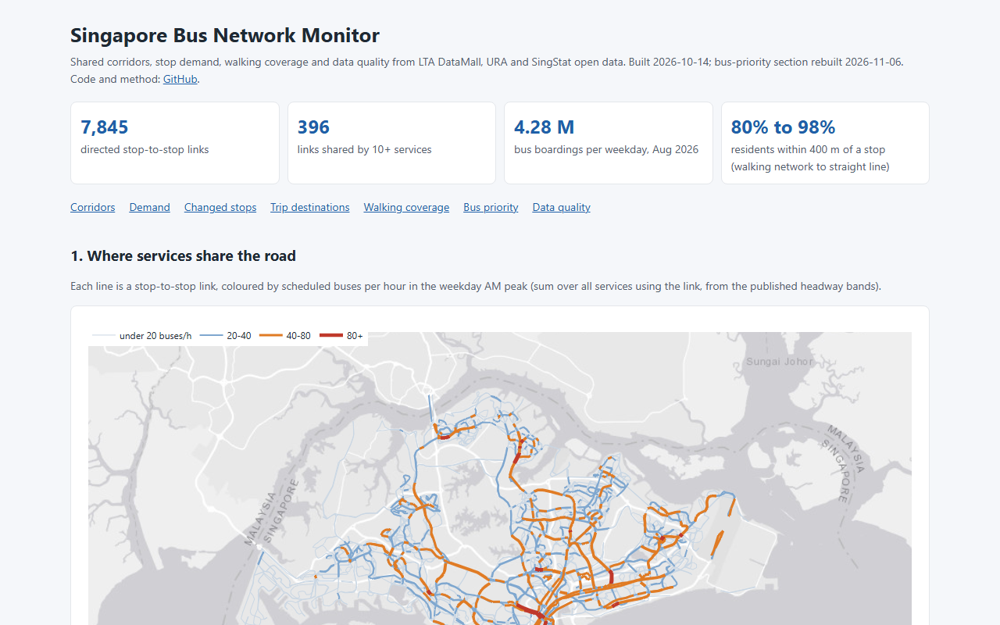

# Singapore Bus Network Monitor

An open-data pipeline and static dashboard for Singapore's public bus network (LTA DataMall, URA, SingStat, OpenStreetMap), with GitHub Actions collectors that archive speed bands and Bus Arrival answers every weekday morning.

- **Demand:** raw totals show weekday boardings falling 11.6% from July to August 2026; per weekday they rose 1.6%.
- **Access:** 79.7–98.5% of residents live within 400 m of a stop, from the walking network (lower bound) to straight lines (upper bound).
- **Bus priority:** over 14 weekday mornings the ranking of 3,378 links is broadly stable (median Kendall's tau 0.80), but two mornings' top 20s share only half their links (median overlap 0.50).
- **Forecasts:** a graph neural net's 0.30 km/h gain over persistence on one test morning did not hold on later mornings; LightGBM did best when each morning was held out in turn (mornings to 23 October).
- **Bus Arrival:** over 15 weekday mornings, ETA error grows from 42 s (MAE, 0–2 min ahead) to 104 s (10–20 min), buses come later than predicted at long horizons, and 7.3% of headways are bunched.
- **Limits:** arrivals are inferred from predictions (±1 min); speed bands describe general traffic, not buses; the demand, OD and anomaly results need DataMall files it no longer serves, and the network steps rebuild only against today's network ([What can be rebuilt](#what-can-be-rebuilt)).

It covers:

- where services share the road;
- when people board and where their trips go;
- which stops changed from one month to the next, and why;
- how many residents can reach a stop within 400 m;
- which shared corridors are slow enough to screen for bus priority, and how stable that list is from morning to morning;
- how far ahead speed bands can be forecast on the road graph;
- how accurate the live bus arrival predictions are, and how regular the headways, on three trunk corridors;
- what public data says about bus safety;
- what the network earns and costs, and what fare changes would do.

**Dashboard:** https://luoaini1213.github.io/sg-bus-network-monitor/



Data:

- LTA DataMall: the September 2026 network; stop and origin-destination passenger volumes for February, June, July and August 2026; traffic speed bands; Bus Arrival (v3) at 41 corridor stops.
- URA Master Plan 2019.
- SingStat General Household Survey 2025.
- OpenStreetMap.
- Official notices and calendars, used to verify causes.
- Traffic Police, SingStat and Ministry of Transport road-safety statistics; LTA DataMall Traffic Incidents.
- PTC fare tables and fare reviews; LTA audited Bus Contracting accounts and contract awards.

Every table has recorded quality checks. Not every result can be rebuilt from today's downloads: [What can be rebuilt](#what-can-be-rebuilt) says which ones a clean clone reproduces and which need archived raw files.

## Findings

### Shared corridors

- 7,845 directed stop-to-stop links make up the 799 service-directions that have routes.
- 396 links are shared by 10 or more services, and 230 are scheduled for 60 or more buses an hour in the weekday AM peak.
- The busiest link is Orchard Rd from Dhoby Ghaut Stn to Bencoolen Stn Exit B: 28 services and about 162 scheduled buses an hour.
- By road, the most kilometres of links carrying 10+ services are on Marine Parade Rd (6.0 km), Yio Chu Kang Rd (4.8 km) and Telok Blangah Rd (4.4 km).

### Monthly totals mislead unless divided by day counts

- Raw DataMall totals show weekday boardings falling 11.6% from July to August 2026.
- Per weekday, boardings actually rose 1.6%, from 4.21 M to 4.28 M. July had 23 weekdays; August had 20, after the National Day Monday holiday.
- The pipeline uses the MOM 2026 holiday list for every comparison.

### Where trips go (origin-destination)

- About 4.28 M bus trips are made per weekday.
- 54% start and end in the same planning area, so buses mostly carry local and feeder trips.
- Trip lengths are short:
  - the median straight-line distance between tap-in and tap-out is 1.5 km;
  - 90% of trips are under 5.8 km.
- The busiest stop-to-stop flows cross the Causeway: Woodlands Checkpoint to Johor Bahru Checkpoint, about 22,400 trips a weekday.
- The busiest pairs of planning areas are Tampines and Bedok, about 28,700 trips each way.
- As a consistency check between the two DataMall products, OD trip totals match the stop tap-in totals to within 0.014% in both months.

### Stops that changed, and why

Each stop's August weekday boardings are compared with the **median of February, June and July**. The first version compared August with July alone, which made the polytechnics look like big drops: their July was a full teaching month and their August is exams.

Against the median baseline, 71 stops are flagged: 67 surges and 4 drops. Each flag is checked against three things: the monthly series, the services at the stop (DataMall routes, April against September) and official notices. See [`docs/ANOMALIES.md`](docs/ANOMALIES.md).

Verified causes:

- **The Float @ Marina Bay** fell 96% because LTA closed the stop from 4 August to 12 October 2026 while the Formula 1 race was being prepared.
- **The Jurong West St 75 reopening** on 19 July accounts for the new stops Gek Poh Shop Ctr and Blk 749, and for the drops at Blk 861 (−64%) and Blk 745 (−53%). The services 181/243/258/502/651 left those two stops.

Explained by calendars:

- 39 surges match the university and ITE terms. NUS and NTU started teaching on 10 August, SMU on 17 August and ITE on 13 July.
- 7 more follow the MOE school-term shape, with the June holidays sitting inside the baseline.

Still open: 4 sustained steps (e.g. Science Park II) and 14 stops have no verified cause. They stay as leads.

### Who can reach a stop within 400 m

Residents (GHS 2025) are placed on Master Plan housing parcels, weighted by plot ratio. Reach is then measured three ways:

| Measure | Residents covered |
|---|---|
| Straight line, 400 m (upper bound) | 98.5% |
| Straight line, 308 m (400 m with a 1.3 detour factor) | 96.7% |
| Along the OpenStreetMap walking network, 400 m (lower bound) | 79.7% |

The 79.7% is an archived measurement from the original graph builder. A separate [walking-graph review](docs/WALK_GRAPH_REVIEW_20261012.md) fixes duplicate-weight aggregation and exact zero-snap boundaries using actual Parquet fixtures. The original city inputs are unavailable in that review checkout, so the archived outputs remain unchanged and no corrected city-wide estimate is claimed.

- The walking-network figure is a lower bound. OSM misses many void-deck and covered-linkway shortcuts in HDB estates: the median walking-to-straight-line ratio comes out at 1.77, above typical urban values.
- The ranking is stable across all three measures. The lowest areas are the landed estates of **Tanglin** (45–82%) and **Bukit Timah** (50–76%), then Bishan and Tengah.
- Spreading residents evenly over each subzone instead of onto housing land creates false gaps. Yishun would appear at 93.7% because Lower Seletar Reservoir sits inside one of its subzones.

### Bus priority screening

Links are ranked by scheduled bus-hours lost per hour: AM peak buses per hour × km × (1/peak speed − 1/night speed), with speeds from LTA traffic speed bands. Each link needs at least four valid snapshots in each period. In each snapshot, segments with finite positive speeds and lengths must cover at least half the bus link's length; missing observations do not count as zero speed. The first sampler took a snapshot about every 20 minutes. The collector restarted on 13 October takes one every 15 minutes.

The screen runs morning by morning (`src/priority_days.py`):

- A link's speed on a morning is the median of that morning's covered snapshots between 07:30 and 09:30, with at least four of them.
- Its multi-morning AM speed is the median of those daily speeds, and it needs data on at least half the mornings.
- The night reference is every night snapshot (22:00–05:00) in the archive.

With one morning the code reproduces the earlier single-morning CSV exactly: same 3,378 links, same order, values equal to within 1e-13.

**Fourteen weekday mornings, 16 October to 5 November 2026 (rerun on 6 November).** These are the GitHub Actions snapshots on the `data-collect` branch, at commit `1aad772`. A morning counts when it has at least four snapshots between 07:30 and 09:30: 16 October and 5 November have 4, 4 November 5, 19 October 6, and the other 10 mornings 7 to 9. 6 November (3 snapshots) is left out, and 3 November has no morning snapshot. The laptop archive (28 September, 14 October and its 89 night snapshots) is not on that branch, so it is not in this run. The inputs were rebuilt without the raw route files (`src/cloud_inputs.py`), and the speed-band match is the same as in the earlier runs: 3,378 eligible links.

- **Night reference.** 58 snapshots, all between 00:32 and 05:00; only one is before 01:00 (`by_hour` in `outputs/priority_screen_metadata.json`). GitHub starts the night jobs hours late, so none falls between 22:00 and midnight. In the six-morning run of 23 October, the 16 night snapshots then available (01:56–05:00) were faster than the archived 89-snapshot laptop reference by a median 2.4 km/h, and losses against them were higher: with the archived reference the combined network total was 97.4 bus-hours lost per hour instead of 143.7, with a moderately different ranking (Kendall's tau 0.76; 15 of the top 20 unchanged).
- **Eligible links.** 3,378; 2,914 have a positive estimated loss on the combined screen, which totals 142.7 bus-hours lost per hour.
- **Agreement between mornings.** Over the 91 pairs of mornings, Kendall's tau is 0.69–0.83 (median **0.80**) and the top-20 overlap is 0.20–0.80 (median **0.50**). The thin mornings agree least: 16 October (tau 0.69–0.73 with each other morning), and 4 and 5 November (median 0.76 each, against 0.79–0.81 for the other mornings). The broad ordering holds; one morning's top 20 still shares only about half its links with another's. The first screen, on the two laptop mornings, had tau 0.72 and an overlap of 0.40.
- **Combined top 20.** 13 of the 20 are in the daily top 20 on at least 7 of the 14 mornings, and 8 on at least 10. One is on all 14: Jalan Eunos (Opp Blk 322 to Opp Blk 16). Bendemeer Road (Blk 44 to Opp Boon Keng Stn) and Shenton Way (UIC Bldg to Prince Edward Rd Stn Exit 2) are on 13. 16 of the 20 were in the six-morning top 20 of 23 October.
- **Network total.** Estimated bus-hours lost per hour, summed over eligible links, runs from 135.3 (23 October) to 175.6 (4 November) across the 14 mornings; `outputs/priority_by_morning.csv` has every morning. These are not comparable with the 107.2 and 94.9 of the two laptop mornings, because the night reference differs.
- **Not covered yet.** A night reference that covers 22:00–midnight needs night jobs that start on time, and the laptop archive is still not on `data-collect`. `python src/priority.py` re-ranks on whatever mornings `data-collect` holds, and `outputs/priority_stability.json` records the agreement for every pair of mornings.

The dates and snapshot counts are stored with a hash of the displayed CSV in `outputs/priority_screen_metadata.json`. The dashboard shows a top-40 map and a top-10 table.

### Short-term speed forecasts

`src/forecast.py` predicts speed bands 20, 40 and 60 minutes ahead from the last hour of snapshots.

**As of 23 October 2026.** The runs below use the mornings collected by then (the last of them six mornings, 16–23 October). `data-collect` now holds 14 qualifying mornings; the forecasts have not been rerun on them yet, so the tables below are not the latest data.

- **Network.** 3,847 speed-band segments: the 2,598 expressway segments, plus the segments under bus links with 60 or more scheduled AM-peak buses an hour. 4,116 directed edges join each segment to the segments that start where it ends.
- **Models.**
  - Persistence (the last value).
  - A historical average by segment, day type and time of day.
  - LightGBM on own and neighbour lags.
  - A diffusion graph neural net (`src/forecast_gnn.py`, PyTorch, 185,827 parameters). It mixes two hops downstream, upstream and over a learned adjacency, and predicts the change from the last speed.
- **Errors.** In km/h on band midpoints; the bands are 10 km/h wide.
- **Intervals.** 95% moving-block bootstrap over test slots (blocks of 6). The same resamples are used for every model, so each model's paired difference from persistence gets its own interval. From 23 October a second interval resamples whole test days.

**First result, 14 October 2026 (laptop archive).** Split by whole days in time order: training 26–30 September (82 anchor slots), validation 1–2 October (49), test 14 October 00:00–09:40 (15, three of them in the AM peak).

| Model | 20 min MAE | 40 min MAE | 60 min MAE | 20 min RMSE |
|---|---|---|---|---|
| Persistence | 3.42 (2.94–3.54) | 3.97 (3.27–4.52) | 4.45 (3.55–5.29) | 7.28 |
| Historical average | 3.92 (2.95–4.32) | 4.05 (2.97–4.78) | 4.21 (2.97–5.19) | 8.31 |
| LightGBM | 3.35 (2.79–3.50) | 3.65 (2.85–4.18) | 4.11 (2.97–5.05) | 6.37 |
| Graph neural net, mean of 5 seeds | **3.12** (2.62–3.34) | 3.68 (2.84–4.41) | 4.14 (3.00–5.19) | 6.53 |

- **20 minutes.** The graph net's MAE is 0.13–0.50 km/h below persistence (paired interval). All five seeds beat persistence on their own, with single-seed MAEs of 3.09–3.29 (mean 3.16, s.d. 0.08). LightGBM has the lowest RMSE.
- **40 and 60 minutes.** LightGBM and the graph net are level, and both are below persistence. The historical average catches up with persistence at 60 minutes.
- **AM peak.** Only three test slots fall in it: the graph net 3.86, persistence 3.88, LightGBM 4.14. There is no gain where congestion forms.
- **How far this goes.** These numbers come from 15 test slots on one morning. The models were trained on 82 slots from five days of an irregular 18–20 minute archive, and graph-net training reached its 200-epoch cap. **This is not yet a credible general result.** The pipeline re-runs on the growing archive (`python src/forecast.py --test-from <date>`).

**Rerun on the GitHub Actions mornings, 23 October 2026.** `data-collect` holds weekday mornings (06:30–10:00) and a few night pulls, so the models now train on mornings only.

- **Data.** An anchor needs an hour of inputs and an hour of targets on consecutive 20-minute slots. GitHub started most mornings late, so 15 anchors qualify, all between 08:00 and 09:00: one on 19 October, three each on the 20th and 21st, and four each on the 22nd and 23rd. 16 October has none.
- **Split.** Whole days in time order: training 19–20 October (4 anchors), validation 21 October (3), test 22–23 October (8, all in the AM peak). There is one validation day instead of two, because two would leave one training anchor (`python src/forecast.py --test-from 2026-10-22 --val-days 1`).
- **Intervals.** The moving-block interval, then the whole-day interval in brackets. With two test days the whole-day bootstrap can only mix the two, so it is coarse.

| Model | 20 min MAE | 40 min MAE | 60 min MAE | 20 min RMSE |
|---|---|---|---|---|
| Persistence | 3.69 (3.49–4.10) | 4.47 (4.21–5.04) | 4.88 (4.66–5.42) | 7.64 |
| Historical average | 4.61 (4.40–4.85) | 4.90 (4.64–5.15) | 5.21 (5.04–5.32) | 8.65 |
| LightGBM | 3.67 (3.58–3.91) | **4.20** (4.09–4.49) | **4.18** (3.96–4.52) | **6.81** |
| Graph neural net, mean of 5 seeds | **3.64** (3.44–4.05) | 4.21 (3.93–4.77) | 4.41 (4.10–4.91) | 7.14 |

- **20 minutes: the graph net's gain over persistence does not hold.** Its MAE is 3.64 against 3.69, a gain of 0.05 km/h (paired interval 0.04–0.06, [0.01–0.09]); on 14 October it was 0.30 km/h. Single seeds range from 3.65 to 3.70 (s.d. 0.02), and two of the five are no better than persistence. LightGBM is level with persistence (3.67; paired interval −0.19 to +0.10).
- **40 and 60 minutes.** Both learned models beat persistence. At 60 minutes LightGBM is best, 0.70 km/h below persistence (paired interval [0.37–1.03]); the graph net is 0.47 below. The historical average, built from two training mornings, is the worst model at every horizon.
- **AM peak.** All 8 test anchors are in the AM peak, where the 14 October run had three and found no gain. The table above is the AM-peak result.
- **How far this goes.** The models were trained on 4 anchors from two mornings, against 82 anchors in the first run, so this is not a like-for-like repeat: the graph net may need the full days the laptop archive had. What it does show is that the 14 October gain did not carry over to the next mornings measured.

**Leave one morning out, 23 October 2026.** Each of the five mornings with anchors is the test morning once. The morning before it validates (the one after, for 19 October), and the rest train, 7 to 11 anchors per fold. All 15 anchors are predicted out of fold, all in the AM peak (`python src/forecast.py --cv`). The whole-day interval here resamples five test mornings. Two folds are thin: 19 October tests a single anchor, and the 20 October fold validates on one.

| Model | 20 min MAE | 40 min MAE | 60 min MAE | 20 min RMSE |
|---|---|---|---|---|
| Persistence | 3.87 (3.66–4.16) | 4.76 (4.41–5.17) | 5.24 (4.80–5.70) | 7.92 |
| Historical average | 4.52 (4.28–4.57) | 4.70 (4.46–4.76) | 4.90 (4.66–4.95) | 8.22 |
| LightGBM | **3.58** (3.50–3.71) | **4.03** (3.86–4.24) | **4.10** (3.97–4.22) | **6.98** |
| Graph neural net, mean of 5 seeds | 3.80 (3.62–4.10) | 4.45 (4.13–4.87) | 4.66 (4.28–5.04) | 7.47 |

- **20 minutes.** The graph net is 0.07 km/h below persistence (paired interval 0.02–0.09, [0.03–0.12]), and every seed beats persistence on its own (3.81–3.83). LightGBM is 0.29 below (paired interval 0.15–0.47; the whole-day interval, 0.00–0.53, reaches zero).
- **40 and 60 minutes.** LightGBM is best at every horizon: at 60 minutes it is 1.14 km/h below persistence, the graph net 0.58.
- **Verdict.** With more test mornings, the 0.30 km/h gain of 14 October does not hold. The graph net still edges persistence at 20 minutes, by 0.05 to 0.07 km/h on both splits, but LightGBM does better at every horizon. Graph-net training again mostly ran to or near its 200-epoch cap (best epochs 133–199 across folds).

### Bus arrival predictions and bunching (15 weekday mornings, 16 October to 6 November 2026)

`src/busarrival.py` polls DataMall Bus Arrival at the 41 stops of three shared trunk corridors (Marine Parade Rd, Telok Blangah Rd, Orchard Rd) every 2 minutes, and `src/busarrival_analysis.py` scores the predictions against inferred arrivals.

**What the sample is.** Every weekday morning on the `data-collect` branch from 16 October to 6 November 2026 (commit `1aad772`; 3 November has no sweeps): 39,155 stop answers. Every morning runs to 10:00 SGT, but GitHub started most scheduled runs late, so the first answer of a morning ranges from 06:36 (26 October) to 08:58 (6 November); `mornings` in `outputs/busarrival_summary.json` lists each one. The sample therefore leans towards the end of the AM peak (06:30–08:30) and the start of the off-peak: 22,360 of the 80,040 headways are in the AM peak. The manual afternoon run of 15 October is left out. Rerun with `python src/busarrival_analysis.py --data <data-collect>/data/raw/busarrival --from 2026-10-16 --to 2026-11-06` (rerun on 6 November; the first version of this section had the 16 October morning alone).

**How arrivals are inferred.** DataMall gives the next three predicted arrivals per service, but no vehicle id. Successive lists are aligned to follow each bus. A bus has arrived between two answers when its GPS-based (monitored) ETA crosses zero, or when it leaves the list while it was due. No arrival is inferred, and the headway sequence breaks, when a bus drops out while still more than 2 minutes away, when answers are more than 5 minutes apart (including the night between two mornings, and a gap that follows a bus already seen arriving), or when an answer is blank. A prediction is scored only where the bus would still have been seen arriving 10 minutes late before the end of that unbroken run of answers. At this cadence each arrival is known to ±1 minute. The full rule is in the module docstring. The longest stretch without an answer inside any headway is 245 s (`max_answer_gap_in_headway_s`), under the 5-minute limit.

- **Arrivals.** 88,956 inferred: 54,664 from a monitored ETA crossing zero and 34,292 from a bus leaving the list. 992 buses were dropped far from the stop, and 19,433 were still listed when a gap of more than 5 minutes began, which includes every bus still listed at the end of each morning but the last.
- **ETA error by horizon.** 748,667 predictions. Error is observed minus predicted, so positive means the bus came later than predicted.

| Horizon | Predictions | MAE | Bias | Within ±1 min | Within ±2 min | 90th pct. abs. error |
|---|---|---|---|---|---|---|
| 0–2 min | 85,689 | 42 s | +23 s | 83.6% | 97.3% | 78 s |
| 2–5 min | 123,442 | 55 s | +17 s | 65.7% | 91.5% | 113 s |
| 5–10 min | 195,493 | 72 s | +24 s | 51.8% | 83.7% | 146 s |
| 10–20 min | 344,043 | 104 s | +40 s | 39.3% | 68.8% | 211 s |

- **Buses run later than predicted at long horizons.** Arrivals from a monitored ETA crossing zero are almost unbiased up to 10 minutes out (−2 to +4 s). The bias then grows to +21 s at 10–20 minutes.
- **The inference rule moves the bias.** Arrivals inferred from a bus leaving the list carry +47 to +70 s of bias, because a bus leaves the list after it has dwelt and departed. Part of the overall positive bias is therefore the method, not the predictions. The 0–2 minute row also partly scores the system against its own at-the-stop estimate.
- **Monitored against scheduled.** 17.7% of listed buses were not monitored, so their ETA comes from the schedule. They are worse at every horizon: an MAE of 155 s at 10–20 minutes against 96 s for monitored buses, and 108 s against 38 s at 0–2 minutes.
- **Corridors.** The three corridors are within 4 s of each other up to 10 minutes. At 10–20 minutes Orchard Rd is the worst (MAE 106 s), ahead of Marine Parade Rd (104 s) and Telok Blangah Rd (103 s).
- **Headway regularity.** 80,040 observed headways. 567 service-stop pairs have 4 or more. Their median coefficient of variation is **0.43**: 0.45 on Marine Parade Rd, 0.37 on Orchard Rd and 0.42 on Telok Blangah Rd.
- **Bunching.** **7.3%** of headways were shorter than a quarter of the scheduled headway for the period: 5.2% of the 22,360 AM-peak headways and 8.1% of the 57,680 off-peak ones. By corridor: 7.1% on Marine Parade Rd, 7.3% on Orchard Rd and 7.5% on Telok Blangah Rd. About 98% of headways had a scheduled reference. Against the median observed headway instead, the share is 5.2%.
- **Data quality.**
  - 190 of the 39,155 answers (0.5%) were HTTP 200 with no service listed at all. In the 15 October test run the stops around these blanks had listed a median of 12 services, and treated as "every bus left", the blanks produced 116 false "lost" buses in 16 minutes. They are treated as missing answers.
  - When a service was listed, its first ETA was empty in 0.07% of cases.
  - Load codes: 89.0% "seats available" (SEA), 10.9% "standing available" (SDA) and 0.04% "limited standing" (LSD).
  - Every monitored bus had a position; unmonitored ones report 0.0, 0.0.
  - Bus types: 58.7% single-deck, 41.3% double-deck, 0.04% bendy.

### Bus finance and fares

An Excel workbook, [`outputs/bus_finance_model.xlsx`](outputs/bus_finance_model.xlsx), models the money side of the Bus Contracting Model from public sources. Inputs are blue; every other cell is a live formula. `src/finance_model.py` computes the same numbers in Python, and the tests evaluate the workbook's formulas and require them to agree to 1e-9. Method and sources: [`docs/BUS_FINANCE.md`](docs/BUS_FINANCE.md).

Revenue is estimated bottom-up:

- **Rides.** July and August 2026 origin-destination rides are scaled to 2026 day counts (251 weekdays, 114 weekend days and holidays): **1,452 M rides a year**. That is 3.6% above LTA's published 2025 average daily bus ridership × 365.
- **Fare distance.** Each stop pair is priced at the along-route distance on the cheapest service that calls at both stops. 99.6% of rides are on a pair with a common service.
- **Fares.** PTC card fare tables in force from 27 December 2025, for adult, senior/PwD, student and Workfare fares.
- **Fare groups.** In 2019 there were 743,000 senior-card bus rides a day out of 4.10 M. Scaling that by the concession-card mix gives 18.5% senior/PwD, 12.0% student, 3.5% Workfare, 2.3% free (children) and 63.7% adult. This assumes the same rides per card in every concession group.
- **Transfers.** Distance fares are charged per journey, so 27.4% of rides are treated as transfer legs (6.2 M trips made 4.5 M journeys in 2018). Each transfer leg loses the average F(a) + F(b) − F(a + b) of 121 cents.

The resulting model figures, against what LTA and PTC publish:

| | Model | Published | Gap |
|---|---|---|---|
| Bus fare revenue, S$ a year | 1,264 M | 1,075 M (LTA FY2025/26 audited S$1,032 M, restated to December 2025 fares) | +17.6% |
| Extra revenue from the December 2026 fare review | 104 M (+8.2%) | 90 M (PTC's S$97.1 M for bus + TEL, bus share) | +15.0% |

- The revenue gap is the size expected from what the model leaves out. Monthly and concession passes cap heavy users' fares, and the OD data is from 2026 while the accounts are for FY2025/26. The model does not claim to close it.
- The two gaps agree (+17.6% and +15.0%), so the fare-change mechanics hold even where the level is high.
- PTC granted 7.0% overall across bus and rail. On this ride mix the approved bus tables raise bus revenue by 8.2%: 68% of rides are 3.2 km or less, and that band rises most (adult $1.28 to $1.40, +9.4%).
- If every ride paid the adult fare with no transfers, revenue would be S$2,041 M. The published figure is 52.7% of that.

From LTA's audited accounts and contract awards:

- **Cost recovery.** FY2025/26 bus fare revenue covered **51.5%** of the S$2,005 M operating cost.
- **Deficit.** The deficit before grants was S$813 M, **S$0.58 per ride** at 2025 ridership.
- **Contract fees.** The nine tendered awards with published values average **S$4.13 M per service-year** (estimated total fee ÷ term ÷ services).
- **Cost per bus-km.** Service fees per scheduled timetable bus-km come to S$5.24 per bus-km. This is indicative only: the timetable estimate (910,618 bus-km per weekday) leaves out dead running.

Fare scenarios (Scenarios sheet):

- **Uniform +5%.** Revenue rises from S$1,264 M to S$1,327 M with no ridership response. With elasticity −0.2 it reaches S$1,314 M; with −0.5, S$1,295 M. The elasticities are generic short-run values (VTPI), not Singapore estimates.
- **Senior/PwD fares −10%.** About −S$15.9 M a year.
- **Revenue-neutral flat adult fare.** 141.9 cents on trunk services. 73% of trunk rides would pay more, because most rides are short.
- **Affordability.** A commuter making 44 rides a month pays S$56.32 a month at the median ride (2.2 km). At the 90th-percentile ride (8.2 km) the bill is S$82.72 at December 2026 fares, against the S$122 adult pass. That is 1.9% of 20th-percentile household market income (S$4,329).
- **Projection.** FY2026/27 to FY2030/31 uses the reviews' part-year timing, ridership +1.24% a year (2023–2025 trend) and operating cost +1.94% a year (FY2020/21–FY2025/26 trend), with no fare review after 2026. On those inputs the deficit before grants is S$828 M in FY2030/31. Every one of these inputs is a blue cell.

### Bus safety brief

[`docs/BUS_SAFETY_BRIEF.md`](docs/BUS_SAFETY_BRIEF.md) is a one-page bulletin built by `src/safety.py` from Traffic Police, SingStat and LTA tables, Ministry of Transport statements and the live DataMall incident feed. Rates carry exact Poisson 95% intervals.

- **Buses involved per registered bus.** 462 buses were involved in fatal or injury accidents in 2025: **24.6 per 1,000 registered buses** (95% CI 22.4–26.9). The 2017–2019 rate was 25.2, giving a rate ratio of 0.97 (0.88–1.08). The post-COVID rise has returned to the pre-COVID level, not above it.
- **Fatal involvements.** 18 in 2025 against 14 a year in 2022–2024: rate ratio 1.26 (0.68–2.23). There are too few events to call a change.
- **Public buses only.** The Taskforce counted 191, 200 and 185 serious collisions in 2022–2024. Per ride, 2024 against 2022 is 0.87 (0.71–1.07). The bus captain was at fault in 45–50% of them.
- **Exposure gap.** Official bus-km stops in 2014. The 2017 statements imply about 1.19 M bus-km a day, so a public-bus accident rate per bus-km for 2022–2025 cannot be rebuilt from public data.
- **Live incidents (DataMall).** 167 distinct incidents were reported from 13 October 21:44 to 14 October 09:40. 124 of them were on expressways, which few bus routes use. Off expressways, 6 of 43 (14%, 95% CI 5–28%) fell on bus-route segments, which make up 23% of non-expressway road length. Nine were accidents, and none was on a bus-route segment. Half a day of data supports no conclusion; the archive grows with the collector.

## Method

| Step | Script | What it does |
|---|---|---|
| Fetch | `src/fetch_public.py`, `src/datamall.py` | OSM stops, URA MP2019 boundaries and land use, SingStat C020123; DataMall routes, services, stops, passenger volume (stop and OD) and speed bands. The key is read from `LTA_KEY` and never stored. |
| Walking network | `src/walk_network.py` | Streams the BBBike OSM extract and keeps walkable ways (the osmnx `walk` filter): 825,460 segments |
| Build | `src/build_db.py` | Loads everything into DuckDB, derives stop-to-stop links and runs 13 data-quality checks |
| Corridors | `src/corridors.py` | Services and scheduled buses per hour on each directed link |
| Demand | `src/demand.py` | Per-day normalisation, hourly profiles, robust surveillance against a single month or a multi-month median |
| OD | `src/od.py` | Planning-area matrix, top pairs, trip lengths, flows from flagged stops, and the OD vs tap-in check |
| Anomalies | `src/anomalies.py` | Evidence table per flagged stop: monthly series, service changes (renumbering aware), OD changes, category, and verified events from `data/reference/network_events_2026.csv` |
| Coverage | `src/coverage.py`, `src/coverage_walk.py` | Dasymetric population; straight-line and walking-network reach |
| Priority | `src/priority.py` | Matches 143,787 speed-band segments to bus links, then computes peak and night speeds and bus-hours lost |
| Collector | `src/collect.py`, `.github/workflows/collect.yml` | Speed bands every 15 minutes and Traffic Incidents every 2 minutes, written atomically; `status` and `stop` subcommands. A full snapshot is 288 paged calls; at 5- and 10-minute cadences DataMall's call quota cut pulls off after 5-7 snapshots an hour. From 16 October 2026 GitHub Actions takes the weekday-morning and nightly snapshots (`gate`, `next` and `once` subcommands; one looping job per morning and one per night) and commits them to the `data-collect` branch |
| Bus Arrival | `src/busarrival_stops.py`, `src/busarrival.py`, `.github/workflows/busarrival.yml` | Picks the 41 stops of three shared corridors from the corridor analysis, then polls DataMall v3/BusArrival at each one every 2 minutes on weekday mornings: one call every 2.9 s, never in bursts, with quota backoff. Sweeps go to the `data-collect` branch with a manifest |
| Arrival accuracy | `src/busarrival_analysis.py` | Infers observed arrivals from successive next-bus lists, then reports ETA error by prediction horizon, headway regularity (coefficient of variation), bunching and data quality |
| Speed cache | `src/speed_cache.py` | One compressed matrix per day of band speeds for the 39,017 links the analyses use; rebuilt only for days whose files changed |
| Priority by morning | `src/priority_days.py` | The priority rule morning by morning, the median across mornings, and rank stability between mornings |
| Forecasts | `src/forecast.py`, `src/forecast_gnn.py`, `src/cloud_inputs.py` | Persistence, historical average, LightGBM and a diffusion graph neural net on the expressway + bus-corridor road graph |
| Safety | `src/fetch_safety.py`, `src/safety.py` | Accident trends and rates with exact intervals; live incidents against the bus network; writes `docs/BUS_SAFETY_BRIEF.md` |
| Finance | `src/finance.py`, `src/finance_model.py`, `src/finance_workbook.py` | Fare distance and annual rides from OD, scheduled bus-km, the fare and cost model, and the Excel workbook |
| Dashboard | `src/dashboard.py` | Static Plotly page in `docs/` |

Table and column definitions are in [`docs/DATA_DICTIONARY.md`](docs/DATA_DICTIONARY.md).

### Validation

- **Stop positions:** LTA and OpenStreetMap agree to a median 6.5 m. 94.8% of the stops found in both are within 50 m of each other.
- **Speed-band matching:** a road-name rule removes parallel-road errors, such as expressways beside their service roads. It raised name agreement from 76.8% to 98.0% of matched length.
- **OD against stop volumes:** the totals agree to within 0.014% in July and in August.
- **Walking network:**
  - 15% of OSM walking nodes sit in 4,015 small fragments that are not connected to the street network.
  - Points are therefore snapped only to components with 1,000 or more nodes. Without this, coverage came out at 75.3% instead of 79.7%.
- **Network integrity:**
  - Every route stop exists in the stop master, and every route's service exists in the service list.
  - 236 of 26,842 route rows skip a sequence number.
  - One stop lies outside Singapore: Larkin Terminal in Johor Bahru, on cross-border service 170.
- **Tests:**
  - 367 tests, and `tests/mutate.py`, which makes 189 deliberate bugs that must each fail at least one test. CI runs both on Linux and the tests on Windows. `tests/test_readme_numbers.py` checks the headline numbers in this README against the committed outputs.
  - The finance tests evaluate the workbook's formulas without Excel (pycel) and compare 28 headline cells and the scenario grid with the Python model.
  - Which tests each mutant runs, and the test gaps the check has found: [`docs/TESTING.md`](docs/TESTING.md).

### Limits of the numbers

- Straight-line catchments overstate access and the OSM walking network understates it. The two bracket the true figure.
- Headway bands describe scheduled service, not observed buses.
- Speed bands describe general traffic. Buses also stop at bus stops.
- Speed coverage is estimated from matched segment lengths, not a union of road geometry. Band midpoint speeds and the resulting priority scores are screening approximations; the AM sample covers 14 mornings (16 October to 5 November 2026), and the night reference only 00:32–05:00.
- The finance model's fare-group and transfer shares are 2018–2021 proxies, and monthly and concession passes are not modelled. Its revenue is 17.6% above LTA's restated audited figure, and the README reports that gap rather than tuning it away.
- Traffic Police bus counts cover all bus types, and there is no public bus-km series after 2014, so public-bus accident rates per bus-km after 2017 cannot be rebuilt.
- Bus Arrival publishes predictions only, so observed arrivals are inferred from when a bus leaves the next-bus list or its monitored ETA crosses zero. At a 2-minute cadence each arrival is known to about ±1 minute, which is coarse against the 0–2 minute horizon, and part of that horizon scores the system against its own at-the-stop estimate. Headways and bunching come from these inferred arrivals, not from vehicle logs or the operators' fleet management systems.
- A surveillance flag with no verified cause is a lead. It becomes a finding when a source or the next month confirms it.

## What can be rebuilt

Every output is committed. What a clean clone can regenerate depends on the raw inputs, which are not committed (see Data sources):

| Result | Raw inputs | From a clean clone |
|---|---|---|
| Tests and the mutation check | committed fixtures | Yes |
| Bus Arrival accuracy, headways and bunching | `data-collect` branch | Yes, no key. `data-collect` at commit `1aad772` with `--from 2026-10-16 --to 2026-11-06` gives the committed outputs |
| Bus priority screen | `data-collect` speed bands and `outputs/corridor_links.csv` | Yes, no key. It uses every morning on the checkout; at `1aad772` that is the 14 mornings above |
| Forecasts from 23 October on | `data-collect` speed bands | Yes, no key; needs PyTorch. The 14 October result used the laptop archive, which is not published |
| Finance workbook | the database with the OD files below | The tests rebuild the workbook from the committed tables and evaluate its formulas; `src/finance.py` needs the OD files |
| Safety brief | the database, `data/reference/safety/` and the incident archive | The reference tables are committed and `src/fetch_safety.py` refreshes them without a key. The live-incident part used the laptop collector's archive of 13–14 October, which is not published |
| Corridors and the network database | DataMall routes, services and stops (key) | Only against the current network: DataMall serves today's routes, and the outputs used the pull of 26 September 2026 |
| Demand and anomalies | DataMall stop volumes for 2026-02, 2026-06, 2026-07 and 2026-08 (key) | Only while DataMall still serves those months; it serves recent months only. `src/datamall.py pv` asks for exactly these months and exits non-zero naming any it did not get |
| Origin-destination | DataMall OD volumes for 2026-07 and 2026-08 (key) | As for demand |
| Walking coverage | URA and SingStat (no key), the BBBike OSM extract | Yes, from today's BBBike extract rather than that of 20 September 2026 |

`python run_all.py --check` lists the raw files the full rebuild still needs and exits with status 2 when any is missing; `python run_all.py` does the same check before it runs anything.

## Run it

Python 3.11. From a clean clone, with no DataMall key:

```bash
pip install -r requirements.txt -c constraints.txt   # constraints.txt: the versions of the Linux CI run
pip install torch --index-url https://download.pytorch.org/whl/cpu   # forecasts only
python -m pytest -q tests && python tests/mutate.py
git fetch origin data-collect
git worktree add ../dc 1aad772                      # the data-collect commit the outputs used (origin/data-collect: the latest)
python src/busarrival_analysis.py --data ../dc/data/raw/busarrival --from 2026-10-16 --to 2026-11-06
python src/cloud_inputs.py ../dc && python src/priority.py   # priority screen on every morning in ../dc
python src/forecast.py --cv                         # leave one morning out (or --test-from 2026-10-22 --val-days 1)
python run_all.py --check                           # the raw inputs the full rebuild still needs
```

The full rebuild needs a DataMall account key and the raw files in the table above:

```bash
python src/fetch_public.py                          # OSM stops, URA boundaries and land use, SingStat (no key)
curl -o data/raw/Singapore.osm.gz https://download.bbbike.org/osm/bbbike/Singapore/Singapore.osm.gz
LTA_KEY=... python src/datamall.py static pv od     # network; stop volumes 2026-02/06/07/08; OD 2026-07/08
LTA_KEY=... python src/collect.py run --until YYYYMMDDHHMM   # speed bands every 15 min, incidents every 2 min
python src/fetch_safety.py                          # SingStat / data.gov.sg safety and ridership tables
python run_all.py                                   # walking network (first run), database, analyses, dashboard
python src/forecast.py                              # forecasts
```

## Data sources

- LTA DataMall: Bus Routes (pulled 2026-04-22 and 2026-09-26), Bus Services, Bus Stops, Passenger Volume by Bus Stops, Passenger Volume by Origin Destination Bus Stops, Traffic Speed Bands v4.
- URA Master Plan 2019 planning area boundaries, subzone boundaries and land use (data.gov.sg).
- SingStat General Household Survey 2025, table C020123.
- OpenStreetMap contributors: stop positions, and the walking network via the BBBike extract of 20 September 2026.
- Official notices and calendars (LTA, operators, NUS, NTU, SMU, polytechnics, ITE, MOE, MOM), listed with each event in `data/reference/network_events_2026.csv`.
- Basemap tiles: Esri Light Gray Canvas.

- Traffic Police (Singapore Police Force): Traffic Annual 2025 and Road Traffic Accident Statistics 2004-2016. SingStat tables M651281, M651351 and C030012. LTA vehicle statistics MVP01-1 and data.gov.sg d_120bba76c28dd4706e0cf85693827e64 (daily bus-km, 2004-2014). Ministry of Transport replies and the Bus Safety Tripartite Taskforce report. Quoted text and URLs are in `data/reference/safety/public_bus_figures.csv`.
- PTC fare review annexes 2024-2026, and the fares, passes and transfer-rule pages. LTA audited financial statements FY2020/21-FY2025/26 and bus contract award releases. MOT parliamentary replies on concession cards and senior-card trips. VTPI fare elasticities. Every source, with its quoted text, is in `data/reference/finance_sources.json`, `data/reference/finance_assumptions.json` and the workbook's Sources sheet.
- LTA DataMall Traffic Incidents, archived by the collector from 13 October 2026.
- LTA DataMall Bus Arrival v3, archived at 41 stops from 15 October 2026.

Raw data is not committed; [What can be rebuilt](#what-can-be-rebuilt) says which of it the fetch commands still return.

The code is under the MIT licence ([`LICENSE`](LICENSE)). The data, documents and models above stay under their own terms: [`THIRD_PARTY_NOTICES.md`](THIRD_PARTY_NOTICES.md).

### The collector

`src/collect.py` runs for weeks without a terminal.

- **Start.** Run it as its own process so that closing a session does not stop it. In PowerShell, from the repository root: set `$env:LTA_KEY`, then `Start-Process python -ArgumentList "src/collect.py","run","--until","YYYYMMDDHHMM" -WindowStyle Hidden`, then clear the variable. The key is read once and never written anywhere.
- **Status.** `python src/collect.py status` shows the process id, the latest snapshot and the end of the log.
- **Stop.** `python src/collect.py stop` writes a stop file, and the collector exits within about 10 seconds. You can also stop the process whose id is in `data/raw/datamall/collector.pid`.
- **Limits.** Sleep or a reboot stops the collector. Gaps show up in the file list and in `collector.log`.

From 16 October 2026 the weekday-morning and night snapshots are taken by GitHub Actions instead (`.github/workflows/collect.yml`):

- **When.** Every 15 minutes from 06:30 to 10:00 Singapore time, Monday to Friday, from **one job per morning that loops** (changed on 16 October 2026). That morning GitHub ran only 2 of the 15 scheduled 15-minute runs (08:36 and 08:50 SGT): it delays and drops scheduled runs. On 19 October the first morning run started at 08:14 SGT, so the triggers now fire more than two hours before the window (changed on 19 October). One trigger at 04:10 SGT (20:10 UTC, Sunday to Thursday) starts a job that waits for 06:30, then pulls, commits and pushes, and sleeps until the next slot on the 06:30 + 15-minute grid, until the 10:00 pull. The job timeout is 355 minutes (GitHub-hosted jobs stop at 360). The gate accepts a morning job from 04:00 and ends its loop at most 350 minutes after the job started, so a job that started before 04:10 leaves the 10:00 pull to a backup. Three backup triggers at 05:02, 05:51 and 06:41 SGT run in the same concurrency group, so they cannot run beside the loop. A backup that runs after the loop finds every slot already in the day's manifest and pulls nothing. A backup that starts first, because the first trigger was dropped, runs the loop itself: it pulls at once, then joins the grid. Slots are planned by `python src/collect.py next`: a slot within 7.5 minutes of a pull already in the manifest is skipped, and a slot that has passed during a long pull or a quota wait is not caught up. Every night, weekends included, a second loop pulls on the hour from 22:00 to 05:00 for the priority screen's night reference (changed on 20 October 2026). From 16 to 20 October the single night pulls at 01:10 and 03:10 SGT gave one snapshot a night at most: GitHub never started the 01:10 run, and on 20 October it started the 03:10 run at 05:27, after the night window. The night trigger fires at 21:07 SGT (13:07 UTC), and the job waits for 22:00. Two backups follow at 22:37 and 00:13 SGT. As in the morning, a job's last pull is at most 350 minutes after it started, so a job that started at 21:07 stops after the 02:00 pull, and the backup waiting in the concurrency group pulls 03:00, 04:00 and 05:00. A backup that starts after 05:00 pulls nothing. Pulls after midnight go in the next day's folder, so a night job checks out both days and reads both manifests. The gate tells night runs from morning runs by the cron that fired. `python src/collect.py gate` decides in Singapore time and skips morning pulls on the public holidays in `src/demand.py`. A manual run (`workflow_dispatch`) always pulls: `-f iterations=2 -f every_minutes=3` makes two pulls 3 minutes apart, and `-f dry_run=true` runs the schedule without calling DataMall or committing.
- **What.** `python src/collect.py once` makes one speed-band pull and one incident poll per slot. A "Rate limit quota violation" waits 60 and then 120 seconds before the same page is asked for again (three tries in all). A pull still refused for quota is written to the day's manifest as failed, shows as a warning on the run, and the loop carries on to the next slot. Any other failed pull, or a missing key, fails the run when the loop ends, so it shows in the Actions list.
- **Where.** The `data-collect` branch, which shares no history with `main`. Each pull is one commit, pushed at once, so a failure later in the morning loses nothing: `data/raw/speedbands/YYYY-MM-DD/sb_YYYYMMDD_HHMM.csv.gz` (the same format as above) and a `manifest.csv` row with the time, row count and SHA-256, plus the incident poll under `data/raw/incidents/YYYY-MM-DD/`. Link geometry is kept once in `data/raw/speedbands/links/`.
- **Key.** The repository secret `LTA_ACCOUNT_KEY` is passed to that one step as `LTA_KEY`. It is not printed or written to the branch.
- **Stop.** Disable the workflow: Actions > collect speed bands > Disable workflow, or `gh workflow disable collect.yml -R LUOaini1213/sg-bus-network-monitor` (`gh workflow enable` resumes it). The data already on `data-collect` stays.
- **Limits.** GitHub starts scheduled runs late when its runners are busy, and can drop runs. On 20 October 2026 the 04:10 morning trigger started at 07:33 SGT, 3 hours 23 minutes late. If all four morning triggers are late, the morning starts late; if all three night triggers are later than 05:00, the night has no snapshot. The manifest is the record of what arrived. A morning run that starts more than 20 minutes after 10:00 is skipped; one that starts between 10:00 and 10:20 makes one pull, unless the manifest already has a pull in the last 15 minutes. The holiday list covers 2026 only; in 2027 the collector warns and collects every weekday until the list is extended.

The Bus Arrival sample has its own workflow (`.github/workflows/busarrival.yml`, from 15 October 2026):

- **Which stops.** `python src/busarrival_stops.py` writes `data/reference/busarrival_stops.csv`: every stop at an end of a 10+-service link on Marine Parade Rd (19 stops; the most kilometres of such links), Telok Blangah Rd (13; third) and Orchard Rd (9; the busiest single link). Yio Chu Kang Rd, second by length, is left out to keep the call budget down. `data/reference/busarrival_services.csv` lists the 656 stop-services with their scheduled headway bands from the 26 September 2026 BusServices pull.
- **When.** One job per weekday morning. Cron starts it at 04:15 SGT (20:15 UTC), with backup triggers at 05:07, 05:56 and 06:46 in the same concurrency group. Until 19 October the first trigger was at 06:00, and on 16 and 19 October the first morning run started at 07:58. It waits for 06:30 and sweeps until 10:00 (timeout 355 minutes; a job that started before 04:10 stops polling 350 minutes after it started), committing to `data-collect` every 15 minutes so a cancelled run keeps what it pushed. `python src/busarrival.py gate` skips weekends and the public holidays in `src/demand.py`. A manual run polls for the number of minutes given (`gh workflow run busarrival.yml -f minutes=20`); `-f dry_run=true` prints the window without calling DataMall or committing.
- **Call budget.** One call per stop, one at a time, spread evenly over the 120-second sweep: one call every 2.9 s, 1,230 calls an hour, about 4,300 a morning. DataMall does not publish its quota; speed-band pulls failed at 1,440–2,016 calls an hour made in bursts of four parallel requests, while a 2-minute incident poll kept working through the same hours. A quota fault (HTTP 429, or an error body that mentions the quota) ends the sweep, records the remaining stops as skipped, pauses 60, then 120, then 240 s, and doubles the period up to 480 s; five clean sweeps halve it again. On 15 October a speed-band pull (288 calls) ran during the manual Bus Arrival run, and neither saw a quota fault.
- **Where.** `data/raw/busarrival/YYYY-MM-DD/ba_YYYYMMDD_HHMMSS.jsonl.gz`, one line per stop with the arrival time of the answer and DataMall's `Services` list as returned, and a `manifest.csv` row per sweep (period, calls ok / failed / skipped / quota, services listed, SHA-256).
- **Key.** The same `LTA_ACCOUNT_KEY` secret, passed only to the polling step and sent only as the `AccountKey` header.
- **Stop.** `gh workflow disable busarrival.yml -R LUOaini1213/sg-bus-network-monitor`.
