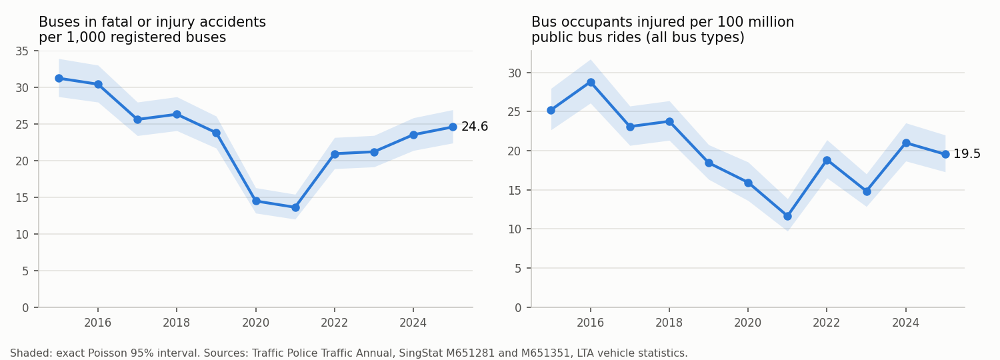

# Bus safety brief: public data, Singapore

Built by `python src/safety.py` from the tables in `data/reference/safety/` and the DataMall incident archive. Every number below is recomputed on each run. Intervals are exact Poisson 95% intervals; comparisons are rate ratios with exact conditional intervals.

## 1. Trend: all buses, Traffic Police data

- **462 buses** were involved in fatal or injury accidents in 2025 (18 in fatal ones), 3.0% of all vehicles involved.
- Per 1,000 registered buses: **24.6** in 2025 (95% CI 22.4-26.9), against 25.2 over 2017-2019. Rate ratio 2025 / 2017-2019: 0.97 (95% CI 0.88-1.08). The post-COVID rise (2021: 13.6) has brought the rate back to its pre-COVID level, not above it.
- Fatal involvements: 18 in 2025 against 14 a year in 2022-2024. Rate ratio 1.26 (95% CI 0.68-2.23): too few events to call a change.
- Bus occupants injured per 100 million public bus rides: **19.5** in 2025 against 18.4 in 2019; 2025 / 2017-2019 0.90 (95% CI 0.78-1.03). Bus occupants killed: 1 in 2025.

## 2. Public buses only (Ministry of Transport / LTA statements)

- 2022: **191** serious collisions involving public buses, 15.1 per 100 million rides (95% CI 13.1-17.4); bus captain at fault in 45%.
- 2023: **200** serious collisions involving public buses, 14.6 per 100 million rides (95% CI 12.7-16.8); bus captain at fault in 50%.
- 2024: **185** serious collisions involving public buses, 13.2 per 100 million rides (95% CI 11.3-15.2); bus captain at fault in 50%.
- 2024 against 2022, per ride: 0.87 (95% CI 0.71-1.07). The Taskforce described the count as stable; per ride it is flat to slightly down, and the interval includes no change.
- LTA's public-bus accident rate fell from about 0.15-0.16 per 100,000 bus-km (2017) to 0.10 (January-August 2021); operators are held to below 0.50 per 100,000 bus-km for each package each month.
- Exposure: the official daily bus-km series stops in 2014 (901,700 km a day). The 2017 figures imply about 1.19 million bus-km a day (270 accidents in January-May at about 0.15 per 100,000 bus-km). Rates per bus-km after 2017 cannot be rebuilt from public data.

## 3. Where live incidents fall relative to the bus network (LTA DataMall Traffic Incidents)

- Archive: 70 polls, 2026-10-13 21:44 to 2026-10-14 00:00 (Singapore time), 50 distinct incidents, 50 within 30 m of a speed-band road segment.
- Road segments used by bus routes are 22.1% of speed-band road length (23.2% of non-expressway length).
- Accidents: 1 reported; 0 on bus-route segments (0%, 95% CI 0%-98%). Off expressways: 0 of 0.
- The feed reports incidents on the road, not whether a bus was involved, and covers expressways more densely than local roads. It has no history, so this archive starts on 13 October 2026; with a few days of data, the shares above are descriptive and their intervals are wide. Per-incident text is not published here.

## 4. What the public data cannot say

- Traffic Police counts cover all buses (public, school, private, excursion) and only accidents with death or injury that must be reported; damage-only accidents are not tracked.
- Bus-occupant casualties exclude pedestrians and other road users hurt in collisions with buses.
- There is no published yearly series of public-bus accidents or of bus-km after 2014, so a system accident rate per bus-km for 2022-2025 cannot be computed from public sources.

## Sources

- Singapore Police Force, Traffic Annual 2025 (tables 1A-1C, 9A-9C) and Road Traffic Accident Statistics 2004-2016 (tables 8A-8C).
- SingStat Table Builder M651281 (casualties) and M651351 (public transport ridership); LTA vehicle statistics MVP01-1; data.gov.sg d_120bba76c28dd4706e0cf85693827e64 (average daily bus-km, 2004-2014).
- Ministry of Transport: Bus Safety Tripartite Taskforce report (2025); replies of 26 July 2021, 4 October 2021 and 8 April 2025. LTA presentation at Busworld South East Asia 2026. URLs and quoted text: `data/reference/safety/public_bus_figures.csv`.
- LTA DataMall Traffic Incidents (collected by `src/collect.py`).
